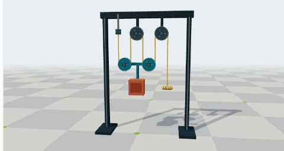

<!--
Copyright (c) 2026, The Isaac Lab Project Developers (https://github.com/isaac-sim/IsaacLab/blob/main/CONTRIBUTORS.md).
All rights reserved.

SPDX-License-Identifier: BSD-3-Clause
-->

# Isaac Lab browser demos

Generated previews of 19 Isaac Lab demos. Newton physics runs locally through
CPU WebAssembly, policies run in the browser, and Three.js renders the scenes.

[Open the gallery](https://maxkra15.github.io/isaaclab-browser-demos/lab/) ·
[Try the pulley workshop](https://maxkra15.github.io/isaaclab-browser-demos/lab/?demo=pulley&rope=newton&wheels=4)

The gallery includes tuning, policy inference, and scripted manipulation. Its
pulley workshop compares massless ropes, VBD cables, and native Newton tendons.
All three use 200 g wheels and the same ideal static force reference.
Only the selected simulation loads. Pause, reset, and scene controls stay in the viewer.



## Embed and preview

Use `lab/?embed=1&demos=all`, or provide a comma-separated list of demo IDs.
The embedding page can synchronize its theme and size through the gallery bridge.

For local preview, serve this checkout over HTTP:

```bash
python -m http.server 8805
```

Open `http://localhost:8805/lab/`. GitHub Pages serves the `pages` branch.
Publish a reviewed, self-contained static export under `lab/`, retaining its
asset and policy license notices. Older gallery entry points redirect to it.

## Reference implementations

The [original source PR](https://github.com/isaac-sim/IsaacLab/pull/7974) and
[published snapshots](https://github.com/isaac-sim/IsaacLab/releases/tag/interactive-demos)
record earlier exporters and scene adaptations. Native tasks and guides live in
[Isaac Lab documentation](https://isaac-sim.github.io/IsaacLab/).
