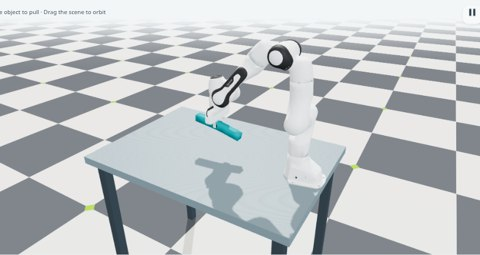
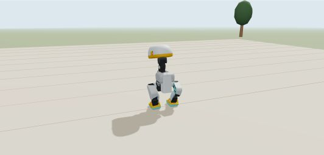

<!--
Copyright (c) 2026, The Isaac Lab Project Developers (https://github.com/isaac-sim/IsaacLab/blob/main/CONTRIBUTORS.md).
All rights reserved.

SPDX-License-Identifier: BSD-3-Clause
-->

# Isaac Lab browser demos

Prototype hosting for interactive Newton demos. Physics and policy inference run
locally in the browser. The reviewed release is now served by
[Isaac Lab documentation](https://isaac-sim.github.io/IsaacLab/demos/v1/).

[Open the prototype gallery](https://maxkra15.github.io/isaaclab-browser-demos/lab/).

## Deformable lab

The mutable [lab preview](lab/README.md) adds a shorter, settled VBD cable,
a Franka contact grasp of a flexible beam, a VBD cloth lifted with an explicit
corner clip, and contrib cube stacking with a contact grasp. The Franka scenes
use scripted Newton IK. Change the material or target, release early, or pull
the deformable with the mouse. Pause and reset are available in every scene.
Ant is hidden from this preview. These prototypes do not change the official
Isaac Lab gallery or PRs.



## MicroDuck prototype

[Play MicroDuck walking](https://maxkra15.github.io/isaaclab-browser-demos/v2/?demo=microduck).
Transparent Move/Turn joysticks sit inside the viewport. MicroDuck starts standing in the authored warehouse. Drag sticks to the edge
to lock a command; pull back or press Escape to stop. Drag the robot to push with 2 N and the background to orbit. Pause and reset
share the viewport toolbar. Physics uses native BAM servos, the published whole-body
asset, and MJWarp contacts; the actor is Pollen Robotics' v5 `velstand.onnx`.



See [setup and physics details](v2/README.md) and the
[exporter](exporters/microduck.py). The exporter reuses `bundle.py` and
`manipulation.py` from the existing source project/reference implementation;
its build requires the internal Newton Web compiler. Running the published demo
requires only a browser.

The [AlphaNIST notes](v2/README.md#alphanist) describe the verified ONNX actor
conversion and the CUDA texture-SDF dependency that must be addressed for faithful
browser physics. AlphaNIST is not published as a runnable browser demo yet.

The NVIDIA-maintained source project is
[Isaac Lab Browser Demos](https://gitlab-master.nvidia.com/omniverse/isaac/isaaclab-browser-demos/-/tree/pages).
The public [reference source](https://github.com/isaac-sim/IsaacLab/pull/7974)
records the original exporters and scene adaptations.

Published version directories are retained unchanged. Synchronize the reviewed
`site/` output from the source project when adding a new version. GitHub Pages
publishes this repository's `pages` branch with no build dependencies.

## Publish a reviewed release

From this mirror's checkout, copy the static output from the source checkout:

```bash
cp -a /path/to/isaaclab-browser-demos/site/. .
git diff --check
git status --short
```

Review and commit the new version, then push to `pages`. Preserve existing version
directories and the third-party license notices. No compiler or simulator is
required to publish an already reviewed release.
